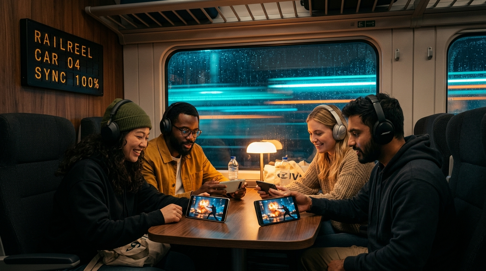

<div align="center">



# 🎬 RailReel

**A private movie theater that travels with you.**  
Watch movies together with friends, kept in step by clock sync — with **zero internet**.

[](https://github.com/kvm404/railreel/releases/latest)
[](https://github.com/kvm404/railreel/releases/latest)
[](LICENSE)

</div>

---

## What is RailReel?

Picture this: you and your friends are on a 6-hour train ride or road trip. Cell service drops to zero. Everyone is bored, but one friend has a movie saved on their phone.

Crowding 4 people around a single 6-inch screen with the speaker blaring is uncomfortable for you and annoying to everyone around you.

**RailReel turns your trip into a private screening room:**

1. One person hosts the movie.
2. Friends connect to the host's portable Wi-Fi hotspot.
3. The movie transfers directly between phones over the local network.
4. Everyone puts on their own headphones, watches on their own screen, and stays **in sync** with the host.

When the host pauses, it pauses for everyone. If someone misses a line of dialogue, they can ask the host for a quick rewind. Floating emoji reactions and group chat let you share the moment together — all without a single byte of internet data.

---

## 📥 Download & Install

RailReel is free, open source, and Android-only (Android 10+).

👉 **[Download the latest RailReel APK](https://github.com/kvm404/railreel/releases/latest)**  
*(Pick the `RailReel-vX.Y.Z.apk` asset on the release page. Older versions and release notes are on the [Releases page](https://github.com/kvm404/railreel/releases).)*

The APK is **universal**: it contains both `arm64-v8a` and `armeabi-v7a` native libraries, so modern 64-bit phones and older 32-bit ARM phones can both install it. Phones must speak the same **protocol version** to join each other; if they don't, the join is refused with an "update both phones to the same version" message.

### Quick 3-Step Setup:
1. **Download** the `.apk` file directly on your Android phone.
2. **Install** the package (if prompted, enable *"Install unknown apps"* for your browser or file manager).
3. **Open the app** — no sign-up, no login, and no email required.

---

## 🚂 How a Movie Session Works

### 1. Pick & Host
The host opens RailReel and chooses a local video file. RailReel checks it **before** anything is shared: it must be **H.264 video in an MP4 or MOV container**, and its audio, if it has any, must be **AAC**. Anything else (HEVC, AV1, MKV, AC-3/DTS audio, ...) is rejected up front with a message that tells you what was found and suggests converting it (for example with HandBrake's "Fast 1080p30" preset). The host can optionally attach a `.srt` subtitle file.

### 2. Connect Your Friends
The host turns on their phone's personal hotspot (Android does not let apps do this, so RailReel guides you). Friends connect their Wi-Fi to the hotspot, open RailReel, and join by tapping the room that shows up automatically, scanning the host's QR code, or opening/pasting the invite link.

### 3. The Host Lets People In
Anyone on the hotspot can *ask* to join, but nobody gets in on their own: the host sees each request and **approves every person**. The movie file and the room's chat, reactions and playback state only go to approved guests.

### 4. The Departure Lounge
Approved guests land in the lobby, where glowing rings show each friend's download progress. When the group is ready, the host taps **Start Show**.

### 5. Press Play, Watch Together
Start Show opens the player on every phone, **paused**. The host then presses **Play** in the player and the whole cabin rolls together. When the host plays, pauses, or seeks, every connected phone follows. If a guest's download falls too far behind, the show pauses for everyone ("waiting for a friend") and resumes when they catch up.

### 6. Reactions, Chat & Playback Requests
- **Floating Reactions**: Tap emoji reactions that drift across everyone's screen.
- **In-Movie Chat**: Chat with your friends without leaving the player.
- **Playback Requests**: Want a snack break? Ask to pause or rewind 15 seconds. The host gets a prompt to allow it with one tap.

### 7. Clean Up When Done
When you leave, you choose: **delete** the downloaded movie and reclaim the storage, or **keep** it. A **fully downloaded** kept copy is reused automatically if you later join a session for the same movie (RailReel checks a fingerprint of the file), so there is no second download. A partial download is not kept for reuse — it starts over next time.

---

## 💡 Good to Know

- **Does it use any mobile data or internet?**  
  None. The hotspot is purely a local Wi-Fi link between devices. You can be in airplane mode in the middle of a desert and it will work.
- **What video formats work?**  
  DRM-free **H.264 video** with **AAC audio** (or no audio) in an **MP4 or MOV** container. The first video and first audio track are checked. Other codecs and containers are rejected before the session starts, with a hint on how to convert. A file with the metadata at the start (a "fast-start" MP4) lets guests begin watching before their download finishes; otherwise they wait for the full download.
- **How tight is the sync?**  
  Every phone plays its own local copy and follows the host's clock, so it is *perceptually* in sync, not frame-locked. On our test devices we measured roughly **50-80 ms of steady-state drift**, which is not noticeable for watching together with your own headphones, but it is not frame-accurate and varies with the phone. See [how sync works](docs/architecture.md#5-sync-protocol-clock-alignment).
- **What if a download is interrupted?**  
  Transfers resume where they stopped after a hotspot drop and retry automatically once the guest reconnects.
- **Can I bring subtitles?**  
  Yes. Select a `.srt` file when hosting and every guest receives it and can toggle captions.
- **How many people can watch together?**  
  RailReel is tailored for comfortable small groups of 4 to 6 people traveling together.
- **Is it secure?**  
  RailReel is built for a small, trusted group on a private hotspot. The room is open to *requests* from anyone on the hotspot, but only guests the host approves get the file or the room traffic. Traffic is plain HTTP/WebSocket on the local network (no TLS), so don't use it on a hostile shared network. Details in [the security model](docs/architecture.md#10-security-model-v1).

---

## 🛠 For Developers

RailReel keeps phones together by aligning **device clocks rather than streaming video pixels**:
- Each phone downloads its own copy of the movie from the host over a native Kotlin (NanoHTTPD) HTTP server with RFC 7233 byte-range support, so transfers can resume.
- An NTP-style clock handshake over a WebSocket control channel (answered natively on the host with a monotonic clock) gives each guest the offset to the host's timeline.
- Each guest derives the host's target playhead and corrects drift locally: inside a ~120 ms deadband nothing happens, small drift is trimmed with playback-rate nudges (up to +/-5% near, up to +/-15% for larger drift), and drift beyond 1.2 s triggers a hard seek.
- A localhost playback proxy lets a guest start watching a fast-start file while it is still downloading.

Read the technical deep dive in [`docs/architecture.md`](docs/architecture.md), and [`CONTRIBUTING.md`](CONTRIBUTING.md) before opening a PR.

### Prerequisites
- [bun](https://bun.sh) **1.3.5** (the package manager and workspace runner; do not use npm/yarn/pnpm)
- Node.js **20.19.4 or newer** (within Node 20, as React Native 0.85 requires)
- JDK **17**
- Android SDK (platform tools + build tools; `ANDROID_HOME` set)
- A **physical Android device** with USB debugging. Emulators can't do hotspots or mDNS multicast, and a real test needs two phones.
- RailReel uses native modules, so it runs in a custom **Expo dev client** build. **Expo Go will not work.**

### Building from Source
```bash
bun install
bun run mobile:android    # build + install the dev client on a connected device (first run is slow)
bun run mobile:start      # start the Metro dev server for the dev client
bun run lint && bun run typecheck && bun run test   # the checks CI runs
```

If you change anything under `apps/mobile/modules/`, `apps/mobile/plugins/`, `app.json` or native dependencies, the dev client must be **rebuilt and reinstalled** (`bun run mobile:android` again). Fast Refresh does not reload native code.

---

<div align="center">
Built as an open-source project. Born on a train. 🚆
</div>
